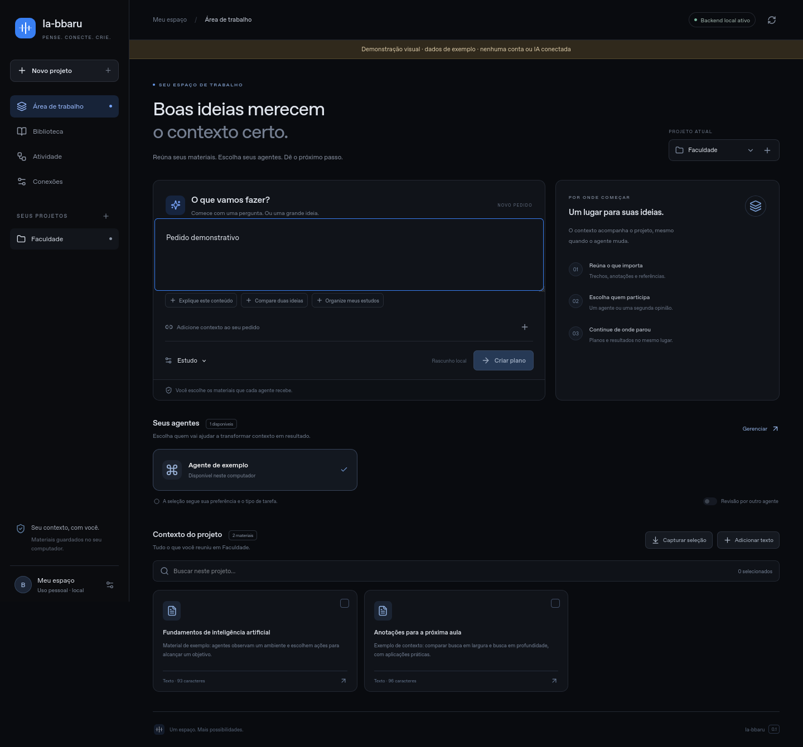

# Ia-bbaru — navegação com agentes de IA

Just a school project.

Projeto independente com a linguagem visual do KInfo. Esta entrega contém o
**painel React, extensão Firefox, ponte local e backend**. Projetos e materiais
funcionam localmente; a integração real de IA está em revisão na PR #1.

**[Instalar no Firefox](docs/INSTALAR_FIREFOX.md)** ·
[Estado e pendências](docs/STATUS.md) · [Configurar gateway 1.1](docs/TESTAR_GATEWAY_1_1.md)

Repositório: https://github.com/Bbarusu/Ia-bbaru



*Prévia capturada em Firefox. Modo de demonstração identificado, com dados fictícios;
nenhuma conta de IA conectada.*

## Primeira etapa aprovada

Construir uma extensão para Firefox, aproveitando Gecko, com painel lateral e
backend local. Validar o fluxo de projeto, contexto selecionado e agentes antes
de manter um navegador independente baseado em Firefox.

- [Briefing do Claude: integrações](docs/INSTRUCOES_CLAUDE.md).
- [Novo briefing do Gemini: evolução do frontend existente](docs/INSTRUCOES_GEMINI.md).
- [Arquitetura Firefox/Gecko e divisão do trabalho](docs/ARQUITETURA.md).
- [Transporte implementado entre extensão e backend](docs/TRANSPORTE_EXTENSAO.md).

## Direção atual: aproveitar contas e assinaturas

O objetivo é usar as contas que o usuário já possui. A proposta é uma interface web
local com um componente local para integrar os caminhos oficiais de cada serviço,
além de transferência assistida de contexto quando a automação não estiver disponível.
O transporte local e o consumidor do contrato 1.1 estão implementados. Claude
registrou testes de assinatura no Windows do usuário; esta entrega do backend foi
validada com fixtures. A instalação da extensão não ativa uma conta automaticamente.

- [Contas, assinaturas e arquitetura proposta](docs/ASSINATURAS.md).
- [Referência visual do KInfo](docs/DESIGN.md).
- [Estado da implementação e próximos passos](docs/STATUS.md).

O contrato 1 permanece compatível e é o padrão. O contrato **1.1** informa as
capacidades reais do transporte, exige aceite por tarefa para limites indicativos
e preserva respostas de conclusão desconhecida sem disparar outro agente.
Isso não implementa automaticamente conexões com ChatGPT ou Gemini.

## Divisão atual

- Backend deste repositório: projetos, fontes de texto, tarefas, plano de execução,
  seleção de modelos, execução em até duas etapas e histórico persistido.
- Serviço de integrações feito com Claude: verificar elegibilidade das contas,
  integrar os caminhos oficiais disponíveis e informar capacidades reais de cada
  conexão. API com chave fica opcional; não contratar cobrança por padrão.
- Codex: implementação inicial de frontend, extensão Firefox, backend principal,
  persistência, coordenação e ponte local.
- Gemini: nova tentativa de evolução do frontend sobre essa base, seguindo
  `docs/INSTRUCOES_GEMINI.md`. O usuário está testando as integrações com Claude.
- Guia para o Claude: `docs/INSTRUCOES_CLAUDE.md`.
- Contratos: `docs/openapi-backend.json`, `docs/openapi-gateway.json` (1) e
  `docs/openapi-gateway-1.1.json` (1.1).

## Executar somente o backend para desenvolvimento

Para usar o aplicativo completo, siga [Instalar no Firefox](docs/INSTALAR_FIREFOX.md).
O instalador provisiona o mesmo token para a ponte e o serviço; não misture esse
fluxo com um token aleatório de outro terminal.

Requer Python 3.12. Os comandos abaixo são para bash:

```sh
python -m venv .venv
source .venv/bin/activate
python -m pip install -r requirements.txt
export LAUNCHER_API_TOKEN="$(python -c 'import secrets; print(secrets.token_urlsafe(32))')"
python -m uvicorn backend.main:create_app --factory --host 127.0.0.1 --port 8000 --workers 1
```

No PowerShell, ative `.venv\Scripts\Activate.ps1`, configure o token usando
`$env:LAUNCHER_API_TOKEN = python -c "import secrets; print(secrets.token_urlsafe(32))"`
e use o mesmo comando uvicorn.

A documentação local estará em `http://127.0.0.1:8000/docs`.
As rotas `/v1/*` exigem `Authorization: Bearer <LAUNCHER_API_TOKEN>`.
`/health`, `/docs` e `/openapi.json` não expõem registros privados.
O arquivo `.env.example` é referência: não é carregado automaticamente.

Para usar o gateway atualizado da PR #1, configure no backend:

```sh
export GATEWAY_URL=http://127.0.0.1:8010
export GATEWAY_PROTOCOL_VERSION=1.1
# Configure GATEWAY_TOKEN com o mesmo segredo de serviço usado no gateway.
```

Não use o token do launcher como token do gateway. As chaves dos provedores ficam
somente no gateway; o navegador não precisa conhecê-las.

Veja [configuração e validação do 1.1](docs/TESTAR_GATEWAY_1_1.md), incluindo o
aceite `allow_unenforced_output_limit` e os comandos para Windows.

## Fluxo disponível

1. `POST /v1/projects`: criar projeto com `title`.
2. `POST /v1/projects/{id}/sources`: adicionar `title` e `content` em texto.
3. `GET /v1/models`: consultar o catálogo real do gateway.
4. `POST /v1/projects/{id}/tasks`: criar plano, sem gerar resposta ou consumir tokens
   de geração. O gateway deve consultar o catálogo sem chamadas de geração.
5. `POST /v1/tasks/{id}/execute`: executar o plano pelo cliente HTTP de desenvolvimento.
   Pode consumir cota/cobrança. Esta operação ainda não é exposta pela extensão.
6. `GET /v1/tasks/{id}`: consultar status e resultados intermediários.

Corpo de criação de tarefa (troque IDs pelos retornados pelas APIs):

```json
{
  "instruction": "Explique o conteúdo e crie cinco exercícios com gabarito",
  "kind": "study",
  "source_ids": ["ID_DA_FONTE"],
  "allowed_model_ids": ["ID_REAL_MODELO_1", "ID_REAL_MODELO_2"],
  "mode": "review"
}
```

`mode: single` usa um modelo. `review` exige dois modelos diferentes: o segundo
recebe a resposta anterior e as fontes selecionadas, e entrega a versão revisada.
`preferred_model_id` e `reviewer_model_id` permitem escolha explícita dentro dos
modelos autorizados. O plano guarda uma cópia das fontes no momento de sua criação.

O roteamento atual é uma regra transparente por categoria configurada, capacidade
de contexto e ordem de preferência do usuário. **Não mede qual IA é melhor** e não
faz uma chamada de IA para decidir o roteamento.

## Limites desta primeira entrega

- Uso pessoal local: um token corresponde a um único espaço de trabalho.
  Não há login multiusuário, isolamento por conta, OAuth nem aplicação pública.
- SQLite e **um único processo/worker**. Não executar múltiplas instâncias sobre
  o mesmo banco; a recuperação de tarefas pressupõe uma instância.
- Execução HTTP síncrona, até 120 segundos por chamada ao gateway. Um futuro
  deployment precisa de fila durável, worker e consulta de progresso independente.
- Falha/timeout não é repetido automaticamente: o provedor pode ter cobrado mesmo
  sem a resposta chegar. Repetir `execute` retorna 409. Uma tarefa interrompida
  pelo reinício passa para `interrupted`, preservando resultados já gravados.
- Respostas cortadas ou de conclusão desconhecida ficam `incomplete`; não são
  apresentadas como concluídas nem enviadas automaticamente à revisão.
- Até 20 fontes por tarefa e 80.000 caracteres de entrada. A contagem em caracteres
  é uma pré-validação; o gateway ainda precisa validar tokens no provedor.
- Fontes apenas em texto. Sem extração de PDF, upload binário, importação NotebookLM,
  sincronização de projetos Claude/ChatGPT, busca vetorial ou ferramentas externas.
- Sem orçamento monetário ou estimativa de preço. Solicitação por etapa: até 4.096
  tokens de saída. No contrato 1.1 o teto só é garantido para `output_limit: enforced`;
  outros transportes exigem aceite da limitação. Usage é registrado quando retornado.
- Sem streaming, cancelamento remoto ou reexecução de etapas.
- Sem credenciais configuradas, `/v1/models` e a criação de planos retornam 503.
  Não existem respostas fictícias no fluxo normal. A prévia visual `?demo=1` é
  explicitamente identificada e não faz inferência.

Antes de publicar: substituir o token único por autenticação e autorização por
usuário, definir retenção/exclusão dos dados e implantar fila durável e limites de
custo. Esta base não deve ser exposta publicamente como está.

## Validação

```sh
python -m unittest discover -s tests -v
cd frontend
npm ci
npm test
npm run build
```

Os testes verificam autenticação, isolamento das fontes entre projetos, roteamento,
passagem de contexto à revisão, limites de entrada, execução única concorrente,
falhas parciais, respostas truncadas, recuperação após reinício e validação do gateway.
Não realizam chamadas pagas a provedores.

A validação opcional de UI usa `python scripts/verify_ui.py` após instalar
`playwright` e executar `python -m playwright install firefox`. Renderiza em Gecko
com backend real e APIs WebExtensions simuladas; não substitui testar o carregamento
nativo da extensão. Nenhuma validação automática exige login de IA.
