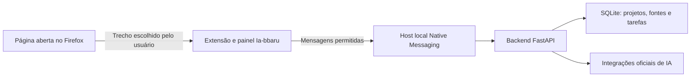

# Ia-bbaru: Firefox/Gecko, extensão e backend local

Decisão de primeira etapa: validar o produto como uma extensão para Firefox,
aproveitando Gecko, com backend local. Depois avaliar um navegador independente.

## Gecko e as alternativas

Gecko é o motor do Firefox. Para a experiência desktop pretendida, usar o Firefox
instalado com WebExtensions é o caminho inicial proposto. Um navegador próprio
poderá partir da base do Firefox, com manutenção das atualizações e da distribuição.
Isso é uma recomendação de arquitetura, não uma afirmação de que toda forma de
embedding desktop é impossível.

GeckoView é a solução documentada pela Mozilla para embedding em Android. Não é
um substituto desktop de Electron/WebView2. Criar uma janela Electron não atende
à escolha de Gecko, porque esse caminho utiliza Chromium.

## Divisão entre as frentes

| Frente | Responsável | Área |
| --- | --- | --- |
| Frontend, captura explícita e extensão Firefox | Gemini | frontend/, extension/ |
| Provedores de IA e autenticação compatível | Claude | integrations/ |
| Projetos, dados, tarefas, coordenação e host local | Codex | backend/, native_host/ |

As pastas não existentes serão criadas pela frente responsável. A fonte de verdade
dos contratos atuais é `backend/contracts.py` e os OpenAPI em `docs/`. Mudanças
entre serviços devem explicitar compatibilidade antes de serem consumidas.

Somente o backend HTTP/SQLite e o cliente de gateway existem hoje. Os demais
componentes do desenho são o trabalho planejado. Login no navegador não implica
que o backend possa extrair conversas ou consumir assinaturas por qualquer rota.

## Marcos

1. Interface Firefox: projeto → trecho selecionado → prévia → fonte persistida.
2. Host local: instalar, diagnosticar e transportar operações curtas com autenticação.
3. Uma integração real e contrato por capacidades, preservando a preferência por
   assinaturas. Sem fallback automático para cobrança de API.
4. Execução durável desacoplada da vida do painel, com resposta e revisão por outro
   agente. O endpoint síncrono atual não atende sozinho esse requisito.
5. Importação de materiais e avaliação de navegador próprio após validar o uso.

## Limites de confiança

Página web, conteúdo capturado e saída de IA são dados não confiáveis. Somente
componentes internos da extensão podem falar com o host; não expor ponte genérica
via postMessage. O host mantém o token de backend fora do conteúdo das páginas e
faz validação de operações, identificadores e tamanho. A instalação do host é
separada da instalação da extensão. Dados de uso e credenciais não vão para Git.

## Referências oficiais

- GeckoView (Android): https://firefox-source-docs.mozilla.org/mobile/android/geckoview/index.html
- Painéis laterais Firefox: https://developer.mozilla.org/en-US/docs/Mozilla/Add-ons/WebExtensions/user_interface/Sidebars
- Ponte local: https://developer.mozilla.org/en-US/docs/Mozilla/Add-ons/WebExtensions/Native_messaging
- Código e distribuição Firefox: https://www.mozilla.org/en-US/about/legal/firefox/

Pesquisa consultada em 6 de novembro de 2026. Não há fork do Firefox nesta base.
