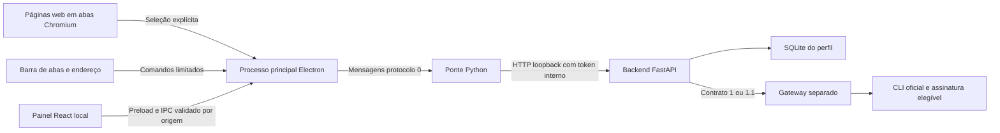

# Ia-bbaru: navegador Chromium e backend local

Em 9/11/2026, o usuário escolheu **Chromium** para iniciar o navegador independente.
A implementação está em `codex/chromium-browser`, baseada na entrega `cbcf3d7`.
Usamos Electron, com Chromium incorporado e interface própria. Não é um fork do
código do Chrome. A extensão Firefox permanece como alternativa de desenvolvimento;
Gecko deixou de ser a direção do navegador.

## Componentes

- `desktop/main.cjs`: janela, abas WebContentsView, navegação, captura, perfil,
  IPC restrito e ciclo de vida do backend/ponte.
- `desktop/ui/`: abas, endereço, controles, atalhos e página inicial do navegador.
- `frontend/`: projetos, materiais, rascunhos, modelos, planos e histórico. O
  adaptador usa `window.iaDesktop` no app ou `browser` na extensão Firefox.
- `desktop/local-service.cjs`: provisiona segredo/porta local e inicia Python.
  O gateway é configurado separadamente; não é iniciado nem autenticado pelo app.
- `backend/` e `native_host/`: contratos, persistência e operações locais existentes.

O perfil contém os dados do navegador, um banco próprio e os rascunhos. Sessões web
persistem em uma partição separada das páginas internas. Dados anteriores da
extensão não são migrados automaticamente. O app adquire um bloqueio de instância
única por perfil.

## Limites de confiança

Páginas web usam sandbox, isolamento de contexto, Node desativado e nenhum preload
do aplicativo. Não recebem token, IPC do painel ou sessões do CLI. Páginas locais
usam CSP e preloads mínimos. Cada handler confere webContents, frame principal e
URL exata do documento interno antes de executar uma operação.

A barra aceita HTTP/HTTPS e pesquisas. Protocolos privilegiados, URLs com credenciais,
navegação de documentos internos e anexação de webviews são bloqueados. Janelas web
novas são direcionadas para abas sem privilégios do processo principal. Downloads e
permissões de dispositivos estão desativados nesta primeira versão.

A captura lê somente a seleção após uma ação do usuário, inclui URL/título e exige
revisão antes de salvar. Há uma captura pendente por vez no desktop. Receber uma
seleção durante edição manual não substitui o rascunho. Páginas e respostas de IA
continuam como dados não confiáveis, renderizados como texto.

Abrir ou fazer login em NotebookLM, ChatGPT, Claude ou Gemini não concede ao gateway
uma API de assinatura. Não há extração de cookies, importação automática de cadernos
ou uso de endpoints privados. Cada adaptador oficial verifica sua elegibilidade.

## Planejamento e execução

O backend 1.1 persiste aceite/capacidades, revalida planos e trata `unknown` como
incompleto sem chamar o revisor. O painel envia o aceite e o exige para limites
indicativos. Criar plano não gera uma resposta.

**Execução pelo painel ainda depende de coordenação durável.** A ponte desktop
preserva a allowlist do host e recusa `tasks.execute`. O endpoint HTTP síncrono de
desenvolvimento não deve ser exposto diretamente no renderer. Codex fará a fila/
worker e acompanhamento de tarefas no próximo marco.

## Responsabilidades

| Frente | Responsável | Área |
| --- | --- | --- |
| Runtime Chromium, IPC e captura | Codex | `desktop/*.cjs`, `extension/` |
| Dados, tarefas e execução durável | Codex | `backend/`, `native_host/` |
| Interface do navegador e painel | Gemini, sobre a base Codex | `desktop/ui/`, `frontend/` |
| Integrações e autenticação elegível | Claude | `integrations/`, `tests/integrations/` |

Usar a nova base, preservar transporte/aceite e não sobrescrever branches de outras
frentes. Prompts atuais: [Gemini](PROMPT_GEMINI_CHROMIUM.md) e
[Claude](PROMPT_CLAUDE_CHROMIUM.md).

## Teste e distribuição

O [roteiro gráfico](TESTAR_NAVEGADOR_CHROMIUM.md) traz instalação de desenvolvimento
no Windows e testes. O Python continua externo e Electron é obtido via npm.
Instalador assinado, backend empacotado, autoatualização e validação de logins web
são etapas posteriores. Atualizações do Chromium devem acompanhar as versões do
Electron, com testes de regressão.
