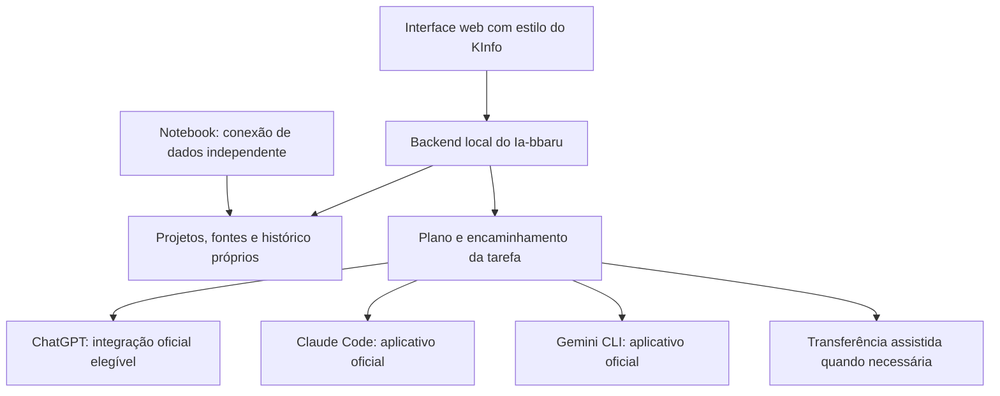

# Usar contas e assinaturas no Ia-bbaru

Pesquisa consultada em 6 de novembro de 2026. Recursos, elegibilidade e condições
mudam; revalidar a documentação no momento de implementar. Não houve login real
nos provedores nem teste de consumo das assinaturas nesta etapa.

## Proposta de arquitetura

Primeira etapa aprovada: extensão Firefox com backend local. Consultar também
`ARQUITETURA.md`; o navegador independente fica para avaliação posterior.

Manter a experiência web, com backend/companheiro inicialmente no computador do
usuário. Ele guarda projetos, fontes selecionadas e resultados. Um adaptador por
serviço usa apenas o caminho oficial disponível. Quando não houver integração
validada, o launcher prepara um pacote de contexto para continuar no aplicativo
e recebe de volta o resultado informado pelo usuário.

O desenho não representa recursos já implementados. Usar a assinatura não significa
uso ilimitado: cotas do plano continuam valendo. Não cair automaticamente para API
paga quando a cota acabar. Componentes locais podem ser usados com interface web;
uma página remota sozinha não executa programas instalados no computador.

## O que a documentação permite considerar

| Serviço | Caminho a validar | Limite relevante |
| --- | --- | --- |
| ChatGPT | Sign in with ChatGPT com autorização de uso do plano em integração elegível | Escopo documentado para apps de código aberto/localmente hospedados; oferta comercial ou remotamente hospedada tem fluxo próprio. Não dá acesso às conversas da conta. |
| Claude | Usuário autenticado no Claude Code oficial, sem modificar o binário | Não transformar tokens da assinatura em uma API genérica do launcher. Validar condições de execução e versão do CLI. |
| Gemini | Gemini CLI oficial com login Google e recursos documentados | Não reutilizar o OAuth do CLI para chamar diretamente o backend do Google por outro cliente. |
| NotebookLM/Gemini Notebook | OAuth específico para notebooks/fontes, quando disponível para a conta | Integração de dados independente do acesso de inferência; Workspace e conta pessoal não têm a mesma disponibilidade. |
| Projetos e conversas existentes | Importação suportada ou exportação explícita de arquivos/instruções | Login para gerar respostas não implica sincronização do histórico do aplicativo. |

### ChatGPT

A documentação oficial apresenta autorização de uso do plano via Sign in with
ChatGPT. É necessário verificar elegibilidade, consentimento e escopos da conta;
login de identidade sozinho não permite inferência. Isso corrige a simplificação
de que toda integração externa necessariamente exige uma chave paga separada.

O fluxo documentado usa streaming e não aceita `max_output_tokens`. Portanto,
**não encaixar silenciosamente esse transporte no contrato v1**. Primeiro declarar
as capacidades da conexão e ajustar validação, limites e estados do backend.
Uma conexão que usa o plano não deve ser rotulada como tendo teto de tokens
garantido pelo servidor se esse teto não existe.

Fontes:
- https://developers.openai.com/siwc/token-sharing-open-source
- https://developers.openai.com/siwc/token-sharing-open-source/preview-limitations
- https://developers.openai.com/cookbook/articles/sign-in-with-chatgpt

### Claude

O caminho proposto é executar o aplicativo oficial, com login feito pelo próprio
usuário no fluxo da Anthropic. A documentação distingue esse uso de um produto que
coleta/intermedeia tokens Claude.ai. Há condições específicas para hospedar ou
oferecer o binário em outro produto; não considerar a assinatura uma credencial
genérica para endpoints Anthropic ou para todo uso do Agent SDK.

O CLI documenta execução não interativa e saída JSON. A versão consultada informa
que `--bare` não usa login por assinatura, portanto não adicionar essa opção como
se fosse neutra. Confirmar o comportamento da versão instalada e controlar
ferramentas, diretório de trabalho e permissões antes de conectar tarefas reais.

Fontes:
- https://code.claude.com/docs/en/legal-and-compliance
- https://code.claude.com/docs/en/headless

### Gemini

O login Google do Gemini CLI pode reconhecer Google AI Pro/Ultra. A documentação
também descreve modo headless com autenticação existente em cache. Isso sustenta
uma prova de conceito com o CLI oficial, mas não autoriza criar outro cliente que
extraia e reaproveite seu token OAuth para acessar os serviços internos do Google.
Validar a forma de integração antes de disponibilizá-la como recurso automático.

Fontes:
- https://geminicli.com/docs/get-started/authentication/
- https://geminicli.com/docs/cli/headless/
- https://geminicli.com/docs/resources/faq/

### Materiais da faculdade e projetos existentes

A API de notebooks consultada usa OAuth. A prévia para contas pessoais não aceita
contas Workspace; há documentação Enterprise separada. Precisamos identificar em
qual conta está o caderno e verificar quais fontes podem ser recuperadas antes de
prometer uma importação integral. Iniciar com escopo somente leitura.

Mesmo sem sincronização automática, os materiais que o usuário importar para o
Ia-bbaru podem formar um contexto comum. Trocar de agente leva instruções, fontes
selecionadas, decisões e resultados do launcher. Não leva memórias privadas ou
todo o histórico de outro aplicativo por efeito do login.

Fontes:
- https://developers.google.com/notebook/docs/authentication
- https://developers.google.com/notebook/docs/notebooks

## Critérios antes de habilitar uma conexão

1. Identificar o plano e o caminho oficial de autenticação, sem solicitar senhas ou
   chaves em conversas. Confirmar se a conexão usa cota da assinatura ou API separada.
2. Validar uma tarefa pequena no computador do usuário, com consentimento para o
   uso da conta. Exibir indisponível se a conexão não estiver pronta.
3. Informar capacidades reais: inferência, revisão, importação de fontes, streaming,
   ferramentas, limites e cancelamento. Não presumir acesso a projetos existentes.
4. Usar contexto explicitamente selecionado, com histórico próprio e rastreio de
   quem produziu cada resultado. Não enviar arquivos pessoais para o GitHub.
5. Evitar duplicar chamadas e registrar falhas sem repetir automaticamente uma
   execução de resultado incerto. Não trocar o modo de cobrança como fallback.

## Próxima entrega proposta

Primeiro verificar uma conexão local oficial, evoluir o contrato por capacidades
e validar uma resposta dentro do launcher. Depois acrescentar a revisão por outro
agente e a conexão de dados com o caderno. Nenhuma dessas conexões já está ativa.
